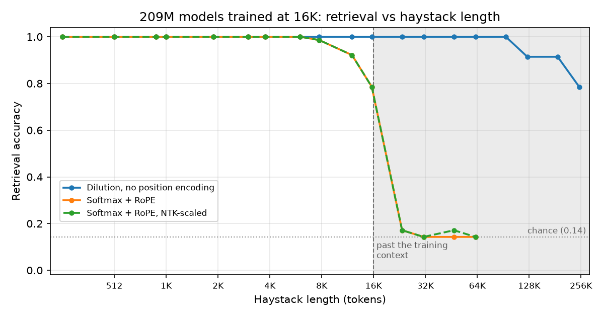
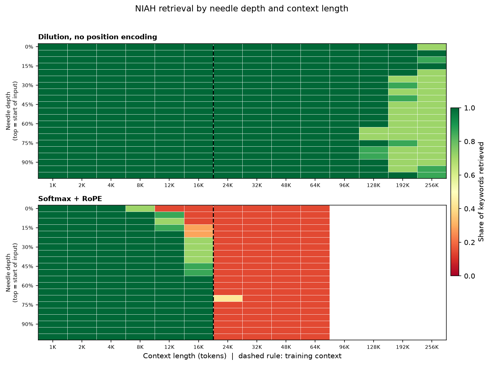

# Niah — a simple, self-contained Needle-In-A-Haystack eval

**Niah** makes it easy to add long-context Needle-In-A-Haystack (NIAH) retrieval
testing to a language model. It bundles everything end to end:

- an **open-source training loop + model** ([nanoGPT](https://github.com/karpathy/nanoGPT), MIT),
- the NIAH eval as a **standalone** run over a checkpoint **and** as a **during-training** eval,
- **charting** tools (the classic depth × context-length heatmap, and side-by-side comparisons of several models), and
- a ready-made **[LM Evaluation Harness](https://github.com/EleutherAI/lm-evaluation-harness)** integration.

The goal is to make NIAH testing a drop-in: train a tiny model, watch retrieval
accuracy evolve during training, then sweep context lengths and chart the result.



*Niah on two published 209M-parameter models trained at a 16K context ([details below](#example-two-209m-models-trained-at-16k)):
softmax attention with RoPE fails just past its training length, while dilution attention keeps retrieving out to 256K.*

## The method (and why it's small-model friendly)

Most NIAH harnesses ask a model to *generate* the hidden fact and then string-match
the output. Tiny or from-scratch models rarely generate cleanly, so that signal is
noisy. Niah instead uses **likelihood-based multiple choice**:

1. Build a haystack of filler text with one needle — `The secret keyword is X.` —
   inserted at a chosen depth.
2. Ask the model to score each candidate keyword as a continuation of
   `…<haystack>\n\n### IMPORTANT DATA: The secret keyword is`. The highest-likelihood
   choice is the model's answer.
3. **Control prior:** small models have lexical biases (some words are just more
   likely). Before scoring, Niah runs the choices against a *needle-free* control
   haystack and disqualifies the ones the model already prefers a priori. This
   isolates genuine retrieval from prior preference, and Niah also reports a
   `prior_adjusted_lift` (retrieval gap minus the control margin).

No generation required, so the eval is cheap and stable even for a 10M-param model.

> **Tokenizer note:** keyword choices must be single tokens, so the model's training
> tokenizer must match the eval tokenizer. The demo trains on the **GPT-2 BPE**
> tokenizer (`gpt2`), which is the default everywhere here.

## Install

```bash
pip install -r requirements.txt
```

Core deps: `torch`, `numpy`, `tiktoken`, `matplotlib`. `transformers` (non-gpt2
tokenizers) and `lm-eval` (harness integration) are optional.

## Quickstart

```bash
# 1. Prepare the demo corpus (tiny-shakespeare, GPT-2 BPE)
python data/shakespeare/prepare.py

# 2. Train a small NIAH-capable model (add --device=cpu if you have no GPU).
#    The demo config runs the NIAH eval during training every 500 steps.
python train.py config/train_niah_demo.py

# 3. Standalone NIAH over the trained checkpoint, sweeping context lengths + charts
python scripts/run_niah.py --ckpt out-niah-demo/ckpt.pt \
    --context-length 64 128 192 --samples 8 \
    --csv-out results/niah.csv --chart results/

# 4. (optional) Re-render charts from a saved CSV/JSON
python scripts/chart_results.py results/niah.csv --out-dir results/
```

During training you'll see lines like:

```
step 500: train loss 3.95, val loss 4.81
step 500: NIAH accuracy 0.333 (retrieval gap -0.56, n=15, ctx=192)
```

> The demo is a from-scratch 10M model on ~300k tokens — accuracy stays modest. It
> exists to exercise the whole loop, not to top a leaderboard. Scale `n_layer`,
> `n_embd`, `block_size`, `max_iters`, and your corpus for real numbers.

## Example: two 209M models trained at 16K

The charts at the top come from two models of the [DilutionAttention](https://github.com/Royer-Research-Labs/Dilution-Attention)
study, both published on Hugging Face: 24-layer, 209M-parameter decoders trained identically at a 16K context on
4.19B FineWeb-Edu tokens, differing only in the attention operator.

| model | attention | Hugging Face |
|---|---|---|
| dilution | dilution attention, no position encoding | [dilution-209m-16k-nope-1x-s2357](https://huggingface.co/Royer-Research-Labs/dilution-209m-16k-nope-1x-s2357) |
| softmax + RoPE | standard softmax attention, RoPE (θ = 500,000) | [softmax-209m-16k-rope-1x-s1337](https://huggingface.co/Royer-Research-Labs/softmax-209m-16k-rope-1x-s1337) |

Both were swept with Niah from 256 tokens to 64K (softmax) or 256K (dilution) haystacks: 8 keywords, 20 depth
placements per keyword inside the training context and 10 past it, scored by likelihood with the control prior (one of
the 8 choices is disqualified, so chance is 1/7 ≈ 0.14). The softmax model is also shown with NTK-scaled RoPE, a common
inference-time fix for longer inputs.

For the depth view the same two checkpoints were swept again with per-placement records (`NiahConfig(record_rows=True)`):
21 needle depths from 0% to 100%, 8 keywords at each depth, from 1K to 64K (softmax) or 256K (dilution). Each cell is the
share of keywords retrieved at that depth and length.



The grid shows where each model fails. Softmax + RoPE starts losing needles placed near the start of the input at 8K-12K,
inside its own training window, then fails at every depth past 16K. Dilution retrieves every needle at every depth to 96K;
past that it degrades gradually and evenly across depths (0.96 at 128K, 0.82 at 192K, 0.76 at 256K overall). These are
single seeds; the DilutionAttention repository has the seed-to-seed comparison. The grid's result files are in
[`examples/real_209m_16k/`](examples/real_209m_16k/).

The charts are made with `scripts/compare_results.py`, which takes one or more result files per model (an in-context
sweep plus extrapolation sweeps are merged) and draws the depth grid whenever the results carry per-placement rows:

```bash
# accuracy vs length (top of this page), from the published sweeps
python scripts/compare_results.py \
    --series "Dilution, no position encoding=dil_16k.json,dil_64k.json,dil_128k.json,dil_256k.json" \
    --series "Softmax + RoPE=rope_16k.json,rope_64k.json" \
    --series "Softmax + RoPE, NTK-scaled=rope_16k.json,rope_64k_ntk.json" --dashed "Softmax + RoPE, NTK-scaled" \
    --trained-length 16384 --chance 0.1429 --out-dir examples --prefix real_209m_16k

# the depth grid, from the per-placement sweeps shipped in examples/real_209m_16k/
python scripts/compare_results.py \
    --series "Dilution, no position encoding=examples/real_209m_16k/dilution-209m-16k-nope-1x-s2357.json" \
    --series "Softmax + RoPE=examples/real_209m_16k/softmax-209m-16k-rope-1x-s1337.json" \
    --trained-length 16384 --chance 0.1429 --out-dir examples --prefix real_209m_16k_rows
```

## Add NIAH to your own training run

The eval is a single call. Given any model exposing nanoGPT's
`forward(idx, targets=None) -> (logits, loss)` and a `.config.block_size`:

```python
from niah.eval import NiahConfig, run_niah

metrics = run_niah(model, config=NiahConfig(context_length=192, num_needles=4,
                                            placements_per_needle=8))
print(metrics["accuracy"], metrics["avg_retrieval_gap_ll"])
```

`context_length` is the length of the scored model input: haystack, separator and
question (plus all but the last token of a multi-token choice). Every row is built to
exactly that many tokens, so `context_length = block_size` fits the model's full
window. The adapter reads the window from `block_size`, `max_seq_len` or
`context_length` on the model's config. Results record `input_length_min/max` and
`haystack_length_mean` so the built lengths can be checked. (Spec version
`niah-v4-spec`. Earlier `niah-v3-spec` files, where `context_length` was the haystack
alone and every prompt ran past it by the question's length, still load with that
meaning and report `length_basis: "haystack"`.)

To wire it into a training loop, copy the small `# --- NIAH ---` blocks in
[`train.py`](train.py) (config flags `niah_eval`, `niah_eval_interval`,
`niah_context_length`, …) and the `estimate_niah()` helper. Set `niah_eval = True`.

## Hard mode

The standard haystack repeats one paragraph and plants one fact, so a model can pass by spotting the only
sentence that breaks the pattern. Hard mode asks the same question under harder conditions:

- **Natural filler.** Each placement's haystack is a contiguous slice of a long natural-text file you supply,
  from a seeded offset, so nothing repeats.
- **Keyed distractors.** Besides the target, `num_distractors` other facts of the same form are planted at
  seeded depths: "The secret keyword for the *Cedar* project is *rain*." The question names one project, and
  every distractor's keyword is itself one of the scored choices, so retrieving "a keyword" without binding
  it to its key picks a distractor.

Scoring is unchanged (likelihood over the choices, the control prior, v4 input lengths). The result adds
`mode`, `num_distractors` and `distractor_pick_rate` (the fraction of placements whose top choice was a
distractor's keyword); with `record_rows=True` each row also records its key, distractors and choice.

```python
from niah import NiahConfig, run_niah

cfg = NiahConfig(context_length=8192, num_needles=8, placements_per_needle=10,
                 mode="hard", filler_path="filler.txt", num_distractors=3)
metrics = run_niah(model, config=cfg, device="cuda")
print(metrics["accuracy"], metrics["distractor_pick_rate"])
```

The filler file needs at least `context_length` + 64 tokens; its SHA-256 is recorded in the spec, so a run
can be reproduced only with the same file. `num_distractors=0` keeps the natural filler alone, which
separates the two difficulties. The code is in [`niah/hard.py`](niah/hard.py).

## Attention diagnostics

`run_niah` says *whether* a model retrieves; `needle_attention_profile` says *which layers
and heads do it*. It builds the same rows the eval scores and, for each one, asks your model
for the attention distribution of the last prompt position (the position that predicts the
answer) in every layer. It then reports the mass on the answer token, on the whole needle
sentence and on token 0, per head and averaged over rows:

```python
from niah import needle_attention_profile

def last_row_attention(ids):          # ids: LongTensor[1, T]
    ...                               # return [layer_attn[:, -1, :] for each layer], each (heads, T)

prof = needle_attention_profile(last_row_attention, context_length=8192, device="cuda")
for layer in prof["layers"]:
    print(layer["layer"], layer["answer_max_head"], layer["needle_mean"], layer["first_mean"])
```

A model that retrieves shows some layer whose best head puts a large share of its mass on
the answer token. `locate_needle(prompt_ids, answer, spec, tokenizer)` is the helper
underneath: it finds the needle in an encoded prompt, matching it without its trailing
space, which merges with the next filler word once the prompt is encoded.

## LM Evaluation Harness

Run NIAH (or any lm-eval task) against your trained model with the bundled adapter:

```bash
python lm_eval_harness/build_dataset.py --tokens 192 --samples 5 --choices 4 \
    --out lm_eval_harness/data/niah_192.jsonl

python lm_eval_harness/run_lm_eval.py --model nanogpt \
    --model_args ckpt=out-niah-demo/ckpt.pt,device=cpu,tokenizer=gpt2 \
    --tasks niah_nanogpt --include_path lm_eval_harness --limit 20
```

See [`lm_eval_harness/README.md`](lm_eval_harness/README.md) for the full guide.

## Project layout

```
niah/                     the eval package (model-agnostic)
  spec.py                 build haystacks / needles / choices; materialize datasets
  hard.py                 hard mode: natural filler + keyed distractors
  eval.py                 run_niah(): the method (control prior + MC scoring)
  model_adapter.py        score a nanoGPT-style model (encode / logits / continuation)
  tokenizer.py            gpt2 (tiktoken) + optional Hugging Face tokenizers
  charting.py             depth × context heatmap, accuracy-vs-context line, multi-model comparisons
model.py, train.py        vendored nanoGPT (MIT); train.py adds the NIAH hook
configurator.py           nanoGPT's config-override helper
config/train_niah_demo.py small, fast, NIAH-capable demo config
data/shakespeare/         GPT-2 BPE corpus prep (train.bin / val.bin)
scripts/                  run_niah.py, prepare_spec.py, chart_results.py, compare_results.py, run_sweep.*
lm_eval_harness/          lm-eval model adapter, task YAML, dataset builder, launcher
examples/                 committed sample results + charts (demo, and the 209M comparison)
```

## Metrics returned by `run_niah`

| key | meaning |
|-----|---------|
| `accuracy` | fraction of placements where the needle is the top choice (passing the retrieval-gap threshold) |
| `avg_retrieval_gap_ll` | mean log-likelihood gap between the needle and the best wrong choice |
| `avg_prior_adjusted_lift_ll` | retrieval gap adjusted for each choice's control-prior margin |
| `early_accuracy` / `mid_accuracy` / `late_accuracy` | accuracy by needle depth bucket |
| `evaluated_needles` / `disqualified_needles` | choices kept vs. removed by the control prior |
| `distractor_pick_rate` | hard mode: fraction of placements whose top choice was a distractor's keyword |

## License

MIT; see [LICENSE](LICENSE). The vendored nanoGPT files (`model.py`, `train.py`, `configurator.py`,
`data/shakespeare/prepare.py`) are © Andrej Karpathy, also MIT; their notice is in [NOTICE](NOTICE).
